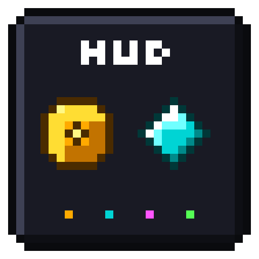

# Ardania Info HUD 2.0.1

<p align="center">
  
</p>

<p align="center">
  <strong>Ein kompaktes, elegantes Client-Side Informations-Overlay für den Minecraft-Server Ardania.de.</strong><br>
  Fabric · Minecraft <strong>1.21.8 – 1.21.11</strong> und <strong>26.2 – 26.3</strong> · Java 21 / 25
</p>

<p align="center">
  
  
  
  
</p>

<p align="center">
  <a href="#features">Features</a> •
  <a href="#downloads">Downloads</a> •
  <a href="#installation">Installation</a> •
  <a href="#konfiguration">Konfiguration</a> •
  <a href="#steuerung">Steuerung</a> •
  <a href="#architektur">Architektur</a> •
  <a href="#release-notes">Release Notes</a> •
  <a href="#bauen">Bauen</a> •
  <a href="#lizenz">Lizenz</a>
</p>

---

<a id="features"></a>
## ✨ Features in Version 2.0.0

* 🖱️ **Visueller In-Game HUD-Editor (freies Verschieben mit Maus und Tastatur)**:
  * Platziere dein HUD völlig frei per **Drag & Drop** oder mit den **Pfeiltasten** (`/ardaniahud edit` oder ModMenu → *HUD frei verschieben ...*).
  * **Versionssichere Eingabe**: 1.21.x (ab 1.21.8) nutzt direktes **GLFW-Polling** und funktioniert damit auch auf **1.21.9–1.21.11**; unter 26.x greift die Dual-Layer-Engine mit **GLFW (26.2)** und **SDL3 (26.3)**.
  * **Magnetisches Einrasten (*Snap-to-Edge & Center*)**: Ränder und Bildschirmmitten rasten mit feinen Cyan-Hilfslinien automatisch ein.
  * **Pfeiltasten-Feinjustierung**: 1 px pro Tastendruck, mit gehaltener `Shift`-Taste 5 px.
  * **Auto-Dodge-Toolbar**: Die Editor-Buttons weichen automatisch nach oben aus, wenn das HUD im unteren Bildschirmbereich liegt.
  * **Sauberes Speichern**: Die neue Position wird erst am Ende des Ziehens bzw. beim Loslassen der Pfeiltasten geschrieben.

* 📐 **Ergonomische 6 feste Positionen (DIN EN ISO 9241-110)**:
  * `Rechts Oben`, `Rechts Mitte` (Hypixel-Stil), `Rechts Unten`, `Links Oben`, `Links Mitte`, `Links Unten`.
  * Direktes Umschalten von Position und Skalierung (75 % bis 125 %) im Konfigurationsmenü.
  * Automatisches Viewport-Clamping verhindert, dass das Overlay bei Auflösungs- oder GUI-Scale-Wechseln aus dem Bild rutscht.
  * *Standard-Preset* stellt die festen Positionen jederzeit wieder her.

* 🛡️ **Intelligenter AFK-Schutz (`/afk` + 10-Block-Distanzprüfung)**:
  * Beim Ausführen von `/afk` stoppt das HUD sofort alle automatisierten Abfragen (`geld`, `ardapoints me`, `jobs stats`, `ontime`).
  * Der serverseitige AFK-Status wird dadurch nicht mehr unterbrochen.
  * Erst wenn du dich mindestens **10 Blöcke** von der AFK-Startposition wegbewegst, erneut `/afk` eingibst oder eine Aufhebungsnachricht erscheint, wird der Sync reaktiviert.

* ⚖️ **Volle Moderator- & Team-Befehls-Kompatibilität**:
  * **Striktes Auto-Sync-Zeitfenster**: Chat-Antworten werden nur unmittelbar nach echten Hintergrundabfragen des Mods unterdrückt; Trennlinien (`----`, `====`), `Name:`-Felder und Rückmeldungen aus `/whois`, `/seen`, `/check`, `/history`, `/baninfo` usw. bleiben sichtbar.
  * **Fremdspieler-Abfragen**: Prüft ein Moderator `/geld <Spieler>`, `/ontime <Spieler>` oder `/whois <Spieler>`, bleiben deine eigenen HUD-Werte unverändert.
  * Während der Chat geöffnet ist oder direkt nach eigenen Befehlen pausiert der Hintergrund-Sync.

* 🌐 **Präzise Unterserver-Erkennung über den Tablisten-Header**:
  * Liest den Header oberhalb der Spielerliste (z. B. `Hauptserver 3 | Minenwelten 2`) und erkennt daran den aktuellen Unterserver – unabhängig davon, ob der eigene Tablisten-Eintrag ein `[H]`/`[M]`-Tag besitzt.
  * Die Tabliste ist netzwerkweit: Für jeden Servertyp wird `Header-Zahl − Tag-Zahl` gebildet. Der eigene Server hat das größte positive Delta; ein Delta von 0 gehört zu einer anderen Welt. Zusätzlich muss das Delta mindestens `1 + ungetaggte Spieler der eigenen Welt` betragen.
  * Tags anderer Spieler, gleiche Welt, Gamemode und Befehlsbaum dienen als Fallback bzw. Tie-Breaker; Konfidenz und Hysterese verhindern Flackern bei unvollständigen Tablisten-Updates.
  * Manuelle Korrektur über **Server-Erkennung** in den Einstellungen (`Automatisch`, `Hauptserver`, `Fallback`, `Mine`, `Event`, `Creative`).

* 🌐 **Robuste Fallback-Server-Erkennung `[F]` & Fehler-Stummschaltung**:
  * Auf dem Fallback-Server werden nach Serverneustarts keine Hintergrundabfragen ausgeführt.
  * Sollte dennoch ein Syntaxfehler (`Unknown or incomplete command...` / `geld<--[HERE]`) durch einen Auto-Sync auftreten, wird er stummgeschaltet.

* ⛏️ **Multi-Job & dezenter Mini-XP-Fortschrittsbalken (Anti-Clutter)**:
  * Erkennt automatisch alle Berufe aus `/jobs stats`.
  * **Zwei Fortschrittsmodi**: kompakte Prozentanzeige (`Mobhunter 80% [24]`) oder ein **subtiler 2-Pixel-Fortschrittsbalken** direkt unter dem Job.
  * Berufe auf Maximalstufe (Level 30) werden als `[MAX]` in Gold hervorgehoben.
  * Umschaltbar: `Prozent` → `Balken` → `Aus`.

* 🏛️ **Intelligente Unterserver-Sichtbarkeitsprofile**:
  * Auf dem **Creative-Server** oder bei **Event-Games** lässt sich das HUD automatisch ausblenden (`Ausblenden`, `Bei Tab`, `Anzeigen`).
  * Nahtlose Wiederanzeige, sobald du auf den Hauptserver oder in die Mine zurückkehrst.

* 💰 **Euronen (Geldanzeige & Live-Gewinn)**:
  * Ruft deinen tatsächlichen Kontostand direkt über die `[ArdaBank]` ab.
  * Reagiert auf Job-Einnahmen (`+0.15$`, `+0,02 Euronen`) und passt das Guthaben automatisch an.
  * **Session-Gewinn & Verdienst**: Erfasst live deinen Netto-Verdienst seit Serverbeitritt inklusive aktuellem Stundensatz (z. B. `+1.234,50 € (+3.400 €/h)`).

* 💠 **ArdaPoints & Voteziel-Erkennung**:
  * Zeigt deine aktuellen ArdaPoints in Echtzeit an.
  * Automatische Erfassung von Daily-Rewards, monatlichen Belohnungen, Server-Votes sowie dem **Voteziel** (`+25 ArdaPoints`).

* ⏳ **Multi-Server-Spielzeittracking (Ontime) & Session-Timer**:
  * Erfasst die Spielzeiten aller Ardania-Welten (`Hauptserver`, `Creative`, `Eventserver`, `Mine`) automatisch beim Serverbeitritt.
  * Frei konfigurierbar: Welten zusammenrechnen oder einzeln auflisten.
  * Optionaler Session-Timer (`Xh Ym Zs`).
  * **Spielzeit-Fix in 2.0.0**: Fremde `/ontime <Spieler>`-Antworten überschreiben nicht mehr die eigenen Werte. Komplette `/ontime`-Blöcke ersetzen die gespeicherten Daten, unbekannte Welten fließen nicht in die Summe ein und veraltete Cache-Einträge werden entfernt.

* 🔢 **Kompakte Zahlenformatierung & anpassbare Deckkraft**:
  * **Kompakte Zahlen**: Optionale K/M-Formatierung (`30,2k €`, `1,5M €`).
  * **Deckkraft**: Hintergrund-Transparenz in 25-%-Schritten von 0 % (unsichtbar) bis 100 % (voll deckend).

---

<a id="downloads"></a>
## 📦 Downloads & Kompatibilität

Ab Version **2.0.0** werden **1.21.x** und **26.x** als zwei getrennte Release-Trains veröffentlicht. Lade immer genau die JAR für deine Minecraft-Version.

| Release-Train | Minecraft | Java | Fabric Loader | Datei | Changelog |
| --- | --- | --- | --- | --- | --- |
| **1.21.x** | 1.21.8 – 1.21.11 | **21+** | ≥ 0.16.13 | `ardania-info-hud-mc1.21.x-2.0.1.jar` | [Release Notes](RELEASE_NOTES_MC1.21.x.md) |
| **26.x** | 26.2 – 26.3 | **25+** | ≥ 0.19.5 | `ardania-info-hud-mc26.x-2.0.1.jar` | [Release Notes](RELEASE_NOTES_MC26.x.md) |

> **Wichtig:** Die Mod ist ausschließlich für **Ardania.de** gedacht und funktioniert nur dort. Es werden keine Daten an Dritte gesendet.

---

<a id="installation"></a>
## 📥 Installation

1. Installiere den [Fabric Loader](https://fabricmc.net/use/) für deine Minecraft-Version:
   * **1.21.x:** Fabric Loader **≥ 0.16.13**, Java **21+**
   * **26.x:** Fabric Loader **≥ 0.19.5**, Java **25+**
2. Installiere die zur Minecraft-Version passende [Fabric API](https://modrinth.com/mod/fabric-api) in deinen `mods`-Ordner.
3. *(Empfohlen)* Installiere [ModMenu](https://modrinth.com/mod/modmenu), um alle Einstellungen bequem im Spiel anzupassen.
4. Lade die passende JAR für Version **2.0.1** herunter und lege sie in deinen `.minecraft/mods`-Ordner:
   * **Minecraft 1.21.8 – 1.21.11**: `ardania-info-hud-mc1.21.x-2.0.1.jar`
   * **Minecraft 26.2 – 26.3**: `ardania-info-hud-mc26.x-2.0.1.jar`
5. Starte das Spiel. Das HUD erscheint automatisch, sobald du dich mit **Ardania.de** verbindest.

> Lege immer nur **eine** der beiden JARs in den `mods`-Ordner.

---

<a id="konfiguration"></a>
## ⚙️ Konfiguration & ModMenu

Die Mod bietet ein übersichtliches, in **3 Reiter (Tabs)** aufgeteiltes Ingame-Einstellungsmenü über **ModMenu** (oder per Datei unter `.minecraft/config/ardania_hud.json`).

### Einstellungsoptionen

* **Tab 1: Anzeige & Layout**:
  * **HUD frei verschieben ...**: Öffnet den visuellen Drag-&-Drop-Editor.
  * **Position**: Voreingestellte Anker (`Rechts Mitte`, `Oben Links` usw.) oder `Frei platziert`.
  * **HUD-Skalierung**: 75 %, 90 %, 100 %, 110 %, 125 %.
  * **Job-XP**: Umschaltbar zwischen `Prozent`, `Balken` und `Aus`.
  * **Hintergrund**: Deckkraft in 25-%-Schritten (0 %, 25 %, 50 %, 75 %, 100 %).
  * **Kompakte Zahlen**: Große Zahlen mit k/M abkürzen (`An`/`Aus`).
  * **Modulare Zeilen**: Euronen, ArdaPoints, Jobs und Session-Gewinn ein-/ausblenden.
* **Tab 2: Spielzeit & Welten**:
  * **Spielzeit anzeigen**: Gesamte Spielzeitanzeige aktivieren (`An`/`Aus`).
  * **Spielzeit zusammenrechnen**: Welten summieren (`An`) oder einzeln auflisten (`Aus`).
  * **Session-Timer anzeigen**: Zeigt die Dauer der aktuellen Sitzung.
  * **Creative-, Event- & Mine-Sichtbarkeit**: `Ausblenden` / `Bei Tab` / `Anzeigen`.
  * **Welten-Auswahl**: `Hauptserver`, `Creative`, `Eventserver`, `Mine` einzeln wählbar.
* **Tab 3: Sync & Slide**:
  * **Auto-Ausblenden (Slide)**: HUD fährt bei Inaktivität sanft zur Seite heraus.
  * **Anzeigedauer**: Dauer bis zum Ausblenden (3 s – 15 s).
  * **Bei Tab anzeigen**: Beim Drücken/Halten der Tab-Taste einblenden.
  * **Sync-Intervalle**: Konfigurierbare Zeiten für Geld, Punkte und Spielzeit.

---

<a id="steuerung"></a>
## 🎮 Steuerung & Befehle

* **`J`** *(Standard)*: Manueller Komplettabgleich aller Werte mit dem Server.
* **HUD Umschalten** *(Standard ungebunden)*: HUD direkt ein-/ausblenden.
* **Chat-Befehle**:
  * `/ardaniahud edit`: Öffnet direkt den visuellen Editor zum freien Verschieben.
  * `/ardaniahud config`: Öffnet das Einstellungsmenü.
  * `/ardaniahud debug`: Statusbericht im Chat ausgeben.
  * `/ardaniahud debug copy`: Statusbericht direkt in die Zwischenablage kopieren.

---

<a id="architektur"></a>
## 🏗️ Architektur & Server-Konformität

* **100 % passiv & regelkonform**: Die Mod führt keine Botting-Aktionen aus. Alle Abfragen werden sanft entprellt, über ein Rate-Limit von 1.500 ms gestaffelt und bei Spieler-Inaktivität, geöffnetem Chat oder AFK komplett pausiert.
* **AFK-Schutz**: Durch Überwachung der Spielerposition im Client (≥ 10 Blöcke) wird der serverseitige AFK-Status nicht gestört.
* **Lokaler Cache**: Der zuletzt bekannte Stand wird in `config/ardania_hud_cache.json` gespeichert. Auf Welten ohne Befehlsunterstützung greift das HUD nahtlos auf diese Werte zurück.
* **Ergonomie nach DIN EN ISO 9241**: Aufgabenangemessen, selbstbeschreibend, erwartungskonform und fehlertolerant.

---

<a id="release-notes"></a>
## 📝 Release Notes

* [Release-Übersicht 2.0.1](RELEASE_NOTES.md)
* [Minecraft 1.21.x – v2.0.1](RELEASE_NOTES_MC1.21.x.md) · inkl. Chat-/LabyClient-Fix, Editor-Fix (1.21.9–1.21.11) und Spielzeit-Fix
* [Minecraft 26.x – v2.0.1](RELEASE_NOTES_MC26.x.md) · gemeinsames JAR für 26.2 und 26.3 inkl. Chat-/LabyClient-Fix

---

<a id="bauen"></a>
## 🛠️ Bauen aus dem Quellcode

**Voraussetzung:** JDK **25 oder neuer** (getestet mit JDK 25/26). Die Targets werden aus `build-targets.json` gelesen.

```powershell
# Beide Targets nacheinander bauen und testen:
.\scripts\build-all.ps1 -JavaHome "C:\Program Files\Java\jdk-26"

# Nur 1.21.x bauen:
.\scripts\build-all.ps1 -JavaHome "C:\Program Files\Java\jdk-26" -Targets mc1.21.x

# Nur 26.x bauen:
.\scripts\build-all.ps1 -JavaHome "C:\Program Files\Java\jdk-26" -Targets mc26.x
```

Die fertigen JARs liegen anschließend unter:

```text
build/distributions/mc1.21.x/ardania-info-hud-mc1.21.x-2.0.1.jar
build/distributions/mc26.x/ardania-info-hud-mc26.x-2.0.1.jar
```

Der Build führt automatisch alle **86 Unit-Tests** aus (Parser, Server-Erkennung, Sync, Layout & Config).

### Projektstruktur

```text
src/main/java        Gemeinsame Logik (Parser, State, Sync, Detector, Layout, Config)
src/main/resources   fabric.mod.json, Mixins, Sprachen (DE/EN/ES/FR)
src/mc121/java       1.21.8–1.21.11-spezifischer Renderer, Config-Screen und HUD-Editor (GLFW)
src/test/java        Unit-Tests
scripts/build-all.ps1  Build + Tests + Distribution pro Target
build-targets.json   Minecraft-Target-Matrix
```

---

<a id="lizenz"></a>
## 📄 Lizenz

Dieses Projekt ist unter der [MIT-Lizenz](LICENSE) lizenziert.
