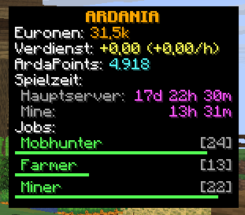
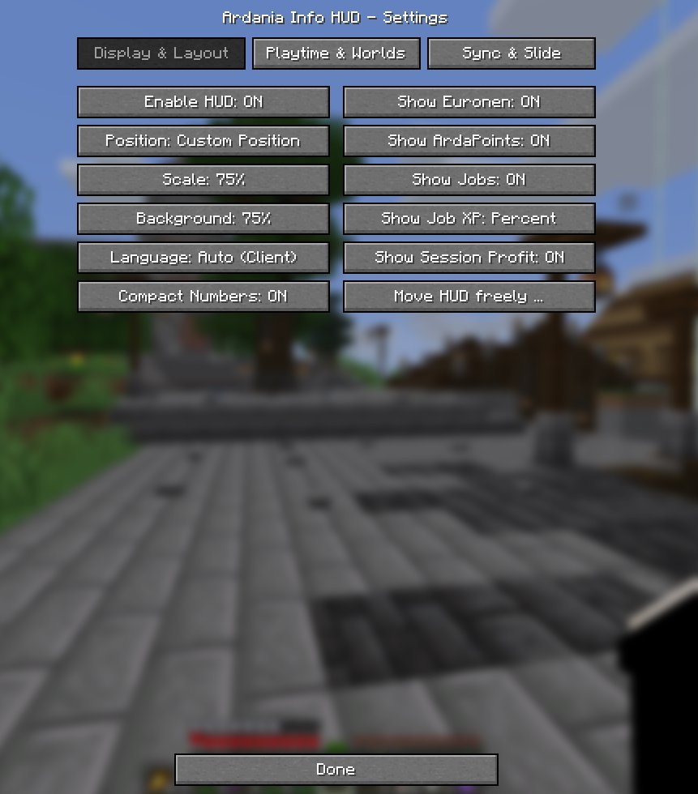
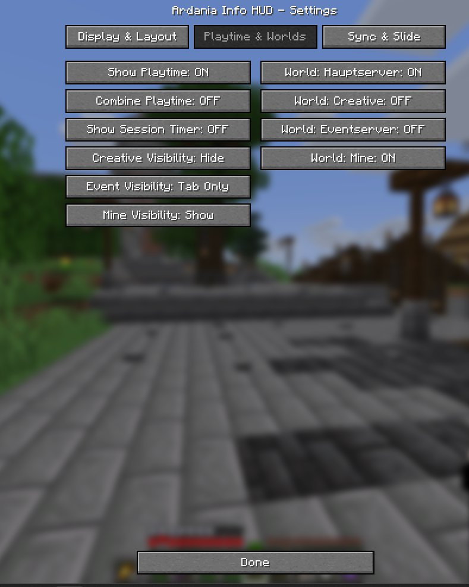
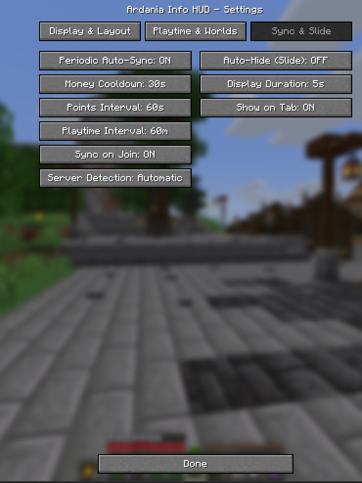

# Ardania Info HUD – Wiki & User Guide (v2.0.0)

> 🌐 **Language / Sprache:** [Deutsch](Home) | **English**

Welcome to the official **Ardania Info HUD** Wiki – a lightweight, client-side Fabric overlay mod built for the German Minecraft server **Ardania.de** (supporting **Minecraft 1.21.8 – 1.21.11** and **26.2 – 26.3**).

---

## 📋 Table of Contents

1. [In-Game HUD Preview](#-in-game-hud-preview)
2. [Opening the Settings](#-opening-the-settings)
3. [Tab 1: Display & Layout](#-tab-1-display--layout)
4. [Tab 2: Playtime & Worlds](#-tab-2-playtime--worlds)
5. [Tab 3: Sync & Slide](#-tab-3-sync--slide)
6. [Saving & Keybinds](#-saving--keybinds)
7. [Diagnostics: `/ardaniahud debug`](#-diagnostics-ardaniahud-debug)

---

## 🖥️ In-Game HUD Preview

The HUD displays your key character and server stats at a glance without forcing you to type chat commands manually:

### Overlay Breakdown *(shown above with German HUD labels)*

* **`ARDANIA`**: Slightly darker title bar at the top of the box.
* **`Euronen: 31,5k`**: Your current currency balance tracked via ArdaBank. In this screenshot, *Compact Numbers* is enabled (`31,5k` instead of the full unformatted amount).
* **`Verdienst: +0,00 (+0,00/h)`** *(Profit)*: Displays your net earnings or spendings since joining the server, plus your projected hourly rate once at least 1 minute has passed in the session (*Show Session Profit*).
* **`ArdaPoints: 4.918`**: Current reward points balance including automatic detection of votes, daily/monthly rewards, and vote goals (*Voteziel*).
* **`Spielzeit:`** *(Playtime, split per world)*:
  * `Hauptserver: 17d 22h 30m`
  * `Mine: 13h 31m`  
  *(Shown separately when **Combine Playtime** is `OFF` and only Hauptserver + Mine are toggled on.)*
* **`Jobs:`** (`Mobhunter [24]`, `Farmer [13]`, `Miner [22]`): Lists all active jobs and levels. In this preview, *Show Job XP* is set to **Bar**, rendering a subtle 2-pixel green progress bar beneath each job. Max-level jobs (Level 30) are highlighted in gold as `[MAX]`.

---

## ⚙️ Opening the Settings

You can access the settings screen at any time in two ways:

* **Via ModMenu** *(recommended)*: `Mods` → `Ardania Info HUD` → Settings icon.
* **Via Chat Command** *(works even without ModMenu)*: `/ardaniahud config` (or `/ardaniahud settings`).
* **Open Position Editor directly**: `/ardaniahud edit`.

The settings screen is organized into three tabs: **Display & Layout**, **Playtime & Worlds**, and **Sync & Slide**.

---

## 🎨 Tab 1: Display & Layout

Use this first tab to customize the **appearance, screen placement, language**, and **which stat rows** appear inside the HUD. *(In the example screenshot above, `Custom Position`, `75%` Scale, `75%` Background, `Auto (Client)` Language, `Compact Numbers: ON`, and `Show Session Profit: ON` are selected.)*

### Left Column (Appearance & Placement)

| Button | Options *(Default)* | Description |
| :--- | :--- | :--- |
| **Enable HUD** | `ON` *(Default)* / `OFF` | Master switch to turn the entire HUD overlay on or off. |
| **Position** | `Middle Right (Hypixel)` *(Default)*, `Top Right`, `Bottom Right`, `Middle Left`, `Top Left`, `Bottom Left` *(or `Custom Position`)* | Cycles through 6 ergonomic screen anchors. If you previously moved the HUD in the editor, this displays `Custom Position`; clicking it switches back to preset anchors and disables the custom coordinates. |
| **Scale** | `75%`, `90%`, `100%` *(Default)*, `110%`, `125%` | Resizes the HUD box cleanly. Automatic viewport clamping keeps the overlay inside the visible screen area. |
| **Background** | `0%`, `25%`, `50%` *(Default)*, `75%`, `100%` | Adjusts the background opacity in 25% steps from `0%` (fully transparent) to `100%` (solid black). |
| **Language** | `Auto (Client)` *(Default)*, `Deutsch`, `English`, `Español`, `Français` | Selects the display language for both the HUD and the settings screen. `Auto (Client)` matches your Minecraft client language (falling back to English). |
| **Compact Numbers** | `OFF` *(Default)* / `ON` | Abbreviates large Euronen amounts (≥ 1,000) using `k` and `M` suffixes (e.g., `31,5k` or `1,5M`) for a cleaner layout. |

### Right Column (Visible Rows & Editor)

| Button | Options *(Default)* | Description |
| :--- | :--- | :--- |
| **Show Euronen** | `ON` *(Default)* / `OFF` | Toggles the `Euronen` currency balance line. |
| **Show ArdaPoints** | `ON` *(Default)* / `OFF` | Toggles the `ArdaPoints` reward points line. |
| **Show Jobs** | `ON` *(Default)* / `OFF` | Toggles your active jobs list parsed from `/jobs stats`. |
| **Show Job XP** | `Percent` *(Default)* → `Bar` → `OFF` | Selects how progress toward the next job level is shown: • **`Percent`**: Displays the percentage beside the level (e.g., `80% [24]`). • **`Bar`**: Draws a subtle 2-pixel progress bar beneath each job (green for active progress, gold for `[MAX]`). • **`OFF`**: Shows only the job name and level `[24]` without XP progress. |
| **Show Session Profit** | `OFF` *(Default)* / `ON` | Shows the `Profit` line tracking your net Euronen change since joining, along with your projected hourly rate (`+/h`) once 1 minute has elapsed. |
| **Move HUD freely ...** | *(opens visual editor)* | Launches the interactive drag & drop editor for pixel-accurate positioning anywhere on screen (details below). |

### Visual HUD Editor (`Move HUD freely ...` / `/ardaniahud edit`)

* **Mouse Drag & Drop:** Drag the preview box freely across the screen. When approaching edges or screen centerlines, **magnetic Cyan snap guides** appear. Hold `Shift` while dragging to disable snapping.
* **Arrow Keys:** Nudge the HUD by `1 px` per press, or hold `Shift` for `5 px` steps.
* **Toolbar:** Includes **`Reset to preset`** (restores anchor presets, 100% scale, and default row order), **`Scale`** (quick scale toggle), and **`Done`**. When dragging the HUD near the bottom edge, the toolbar automatically jumps to the top (*Auto-Dodge*).
* Relative coordinates are saved alongside pixel coordinates so your HUD stays aligned across window resizes.

---

## 🌍 Tab 2: Playtime & Worlds

This tab controls how **playtime** (`/ontime`) and the **session timer** are displayed, as well as **which Ardania sub-servers** show the HUD. *(In the screenshot above, `Combine Playtime: OFF` is selected with only `Hauptserver` and `Mine` toggled on—matching the split display in the HUD preview above.)*

### Left Column (Playtime & Sub-Server Visibility)

| Button | Options *(Default)* | Description |
| :--- | :--- | :--- |
| **Show Playtime** | `ON` *(Default)* / `OFF` | Toggles the playtime section inside the HUD. |
| **Combine Playtime** | `ON` *(Default)* / `OFF` | Switches between combined and per-world display: • **`ON`**: Sums all enabled worlds into a single `Playtime` line. • **`OFF`**: Lists each selected world separately with its individual playtime. |
| **Show Session Timer** | `OFF` *(Default)* / `ON` | Adds a live `Session` stopwatch (`Xm Ys` / `Xh Ym Zs`) counting time spent in the current play session. |
| **Creative Visibility** | `Hide` *(Default)*, `Tab Only`, `Show` | Controls HUD visibility while on the **Creative** sub-server. Hidden by default to avoid clutter while building. |
| **Event Visibility** | `Tab Only` *(Default)*, `Show`, `Hide` | Controls HUD visibility on the **Event** sub-server. |
| **Mine Visibility** | `Show` *(Default)*, `Tab Only`, `Hide` | Controls HUD visibility in the **Mine** worlds. |

> [!NOTE]
> **Visibility Modes Explained:**
> * **`Show`**: Always visible on that sub-server *(unless Auto-Hide in Tab 3 is enabled)*.
> * **`Tab Only`**: Hidden during normal gameplay; slides in when you hold the player list key (`Tab`) and remains visible for the configured *Display Duration*.
> * **`Hide`**: Completely hidden on that sub-server.
>
> *(On **Hauptserver**, the HUD always obeys global visibility rules; on the **Fallback** server `[F]`, it defaults to `Tab Only`.)*

### Right Column (Tracked Worlds for Playtime)

| Button | Options *(Default)* | Description |
| :--- | :--- | :--- |
| **World: Hauptserver** | `ON` *(Default)* / `OFF` | Includes **Hauptserver** playtime in the combined total / per-world list. |
| **World: Creative** | `ON` *(Default)* / `OFF` | Includes or excludes **Creative** server playtime. |
| **World: Eventserver** | `ON` *(Default)* / `OFF` | Includes or excludes **Eventserver** playtime. |
| **World: Mine** | `ON` *(Default)* / `OFF` | Includes or excludes **Mine** server playtime. |

> Other network worlds (e.g., *Skyblock*) are automatically ignored so your Ardania playtime stays accurate.

---

## 🔄 Tab 3: Sync & Slide

Use this tab to configure **background sync behavior & cooldowns**, **sub-server detection**, and the optional **auto-hide slide animation**.

### Left Column (Synchronization & Server Detection)

| Button | Options *(Default)* | Description |
| :--- | :--- | :--- |
| **Periodic Auto-Sync** | `ON` *(Default)* / `OFF` | Enables or disables automatic background queries (both event-triggered syncs after earnings/votes and periodic timers). Queries are rate-limited to ≥ **1,500 ms** apart and automatically pause during `/afk` (until moving 10 blocks), after 5 minutes of inactivity, while chat is open, or on the `[F]` Fallback server. |
| **Money Cooldown** | `15s`, `30s` *(Default)*, `60s`, `120s` | Minimum cooldown in seconds between automatic `/geld` checks triggered by action-bar earnings. |
| **Points Interval** | `30s`, `60s` *(Default)*, `120s`, `300s` | Interval in seconds for periodic `/ardapoints me` refreshes during active play. |
| **Playtime Interval** | `15m`, `30m`, `60m` *(Default)*, `120m` | Interval in minutes for periodic `/ontime` refreshes. Between syncs, the client increments elapsed minutes locally. |
| **Sync on Join** | `ON` *(Default)* / `OFF` | Automatically triggers a single full sync (`geld`, `ontime`, `ardapoints me`, `jobs stats`) 2.5 seconds after joining Ardania or switching sub-servers. |
| **Server Detection** | `Automatic` *(Default)*, `Hauptserver`, `Fallback`, `Mine`, `Event`, `Creative` | Controls how your current sub-server is identified. `Automatic` analyzes the tab-list header counts (`Header − Tag` delta), other players' tab tags, players in your loaded world, game mode, and Brigadier commands. Choose a manual override if detection ever misidentifies a world. |

### Right Column (Auto-Hide / Slide Animation)

| Button | Options *(Default)* | Description |
| :--- | :--- | :--- |
| **Auto-Hide (Slide)** | `OFF` *(Default)* / `ON` | When enabled, the HUD smoothly slides off-screen after the *Display Duration* expires and slides back in briefly whenever Euronen, ArdaPoints, or Jobs update (or when pressing `Tab`). When `OFF`, the HUD remains persistently visible. |
| **Display Duration** | `3s`, `5s` *(Default)*, `8s`, `10s`, `15s` | Controls how many seconds the HUD stays visible during *Auto-Hide (Slide)* updates or after pressing `Tab`. |
| **Show on Tab** | `ON` *(Default)* / `OFF` | Reveals the HUD while holding/pressing the player list key (`Tab`) – especially useful alongside *Auto-Hide* or `Tab Only` world profiles. |

---

## 💾 Saving & Keybinds

* **Done** *(bottom of every tab)*: Persists all changes to `.minecraft/config/ardania_hud.json` and closes the settings screen. (Each button also saves immediately when clicked.)
* **Keybinds** *(under `Options → Controls → Key Binds → Ardania Info HUD`)*:
  * **`J`** *(Default)*: Manually forces a silent full sync with the server.
  * **Toggle HUD** *(Unbound by default)*: Instantly toggles HUD visibility on keypress.
* For contributors, technical notes and Javadoc generation details are available on [Developer & Javadocs](Developer-Javadocs).

---

## 🛠️ Diagnostics: `/ardaniahud debug`

If sub-server detection ever seems inaccurate or background queries appear blocked on a specific world, you can run this local diagnostic command in chat:

* **`/ardaniahud debug`** *(shortcut: `/ardaniahud`)*  
  Prints a client-only status report in your chat, including:
  * Detected **Server Type**, **Confidence (%)**, **Detection Source** (e.g., `HEADER`, `HEADER_COUNTS`, `SELF_TAG`, `OVERRIDE`), and sample age
  * Connected host, captured **Tablist Header & Footer**, parsed header counts, tab-list tags, and calculated **Header-to-Tag Deltas**
  * **Command Tree** readiness (`geld`, `jobs`, `creative`), active **Override**, per-world **Blocked Commands**, and current **Command Queue**
  * Current cached/live HUD stats (`Euronen`, `ArdaPoints`, `Jobs`, `Playtime`) and key **Config values** (`pos`, `autoHide`, `jobXp`, `scale`)

* **`/ardaniahud debug copy`**  
  Prints the same diagnostic report in chat and copies a clean, color-code-free plain-text version straight to your clipboard for bug reports or Discord troubleshooting.
