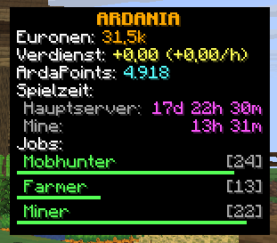
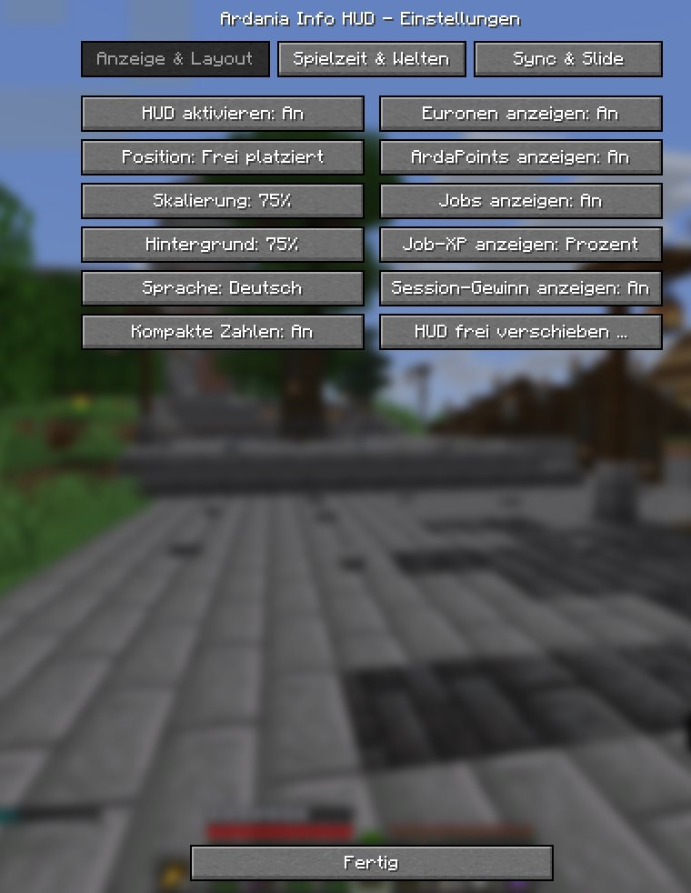
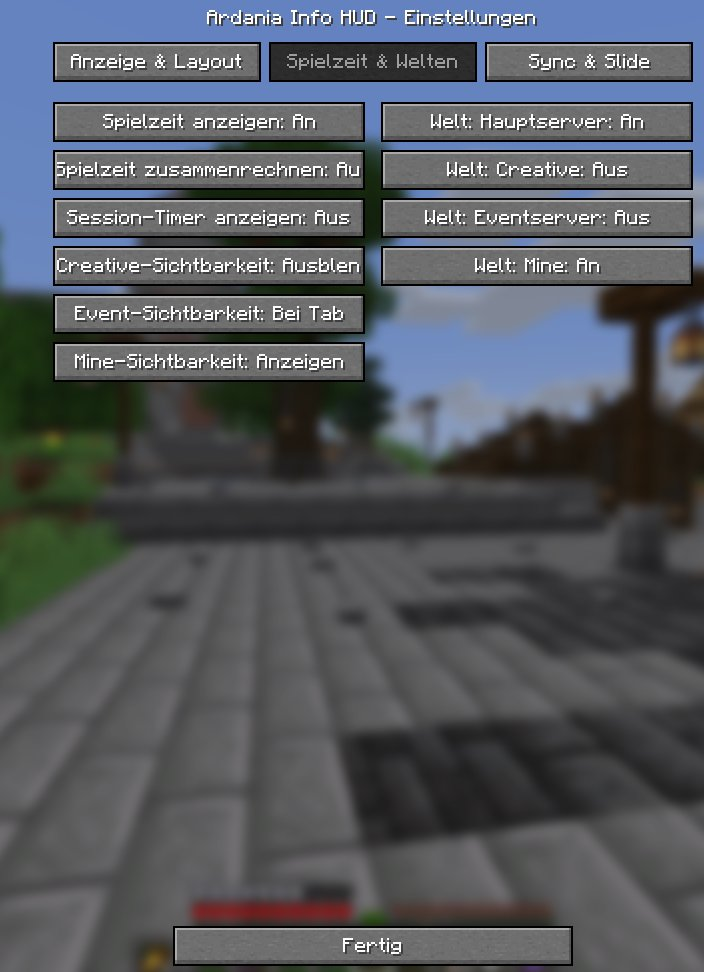
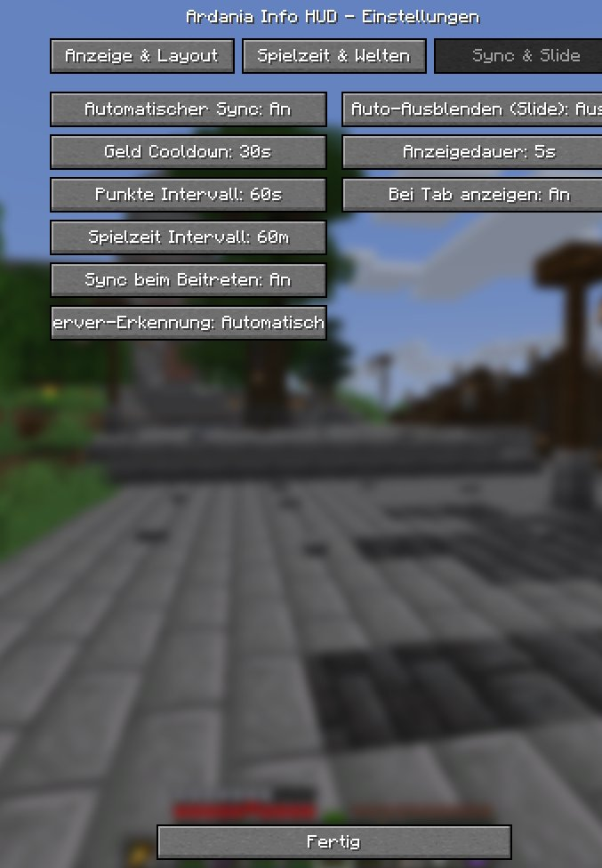

# Ardania Info HUD – Wiki & Benutzerhandbuch (v2.0.0)

> 🌐 **Sprache / Language:** **Deutsch** | [English Version](Home-EN)

Willkommen im offiziellen Wiki von **Ardania Info HUD** – einem clientseitigen Fabric-Informations-Overlay für den deutschen Minecraft-Server **Ardania.de** (unterstützt **Minecraft 1.21.8 – 1.21.11** sowie **26.2 – 26.3**).

---

## 📋 Inhaltsverzeichnis

1. [So sieht das HUD im Spiel aus](#-so-sieht-das-hud-im-spiel-aus)
2. [Einstellungen öffnen](#-einstellungen-öffnen)
3. [Tab 1: Anzeige & Layout](#-tab-1-anzeige--layout)
4. [Tab 2: Spielzeit & Welten](#-tab-2-spielzeit--welten)
5. [Tab 3: Sync & Slide](#-tab-3-sync--slide)
6. [Speichern & Tastenbelegung](#-speichern--tastenbelegung)
7. [Diagnose: `/ardaniahud debug`](#-diagnose-ardaniahud-debug)

---

## 🖥️ So sieht das HUD im Spiel aus

Das HUD zeigt dir alle wichtigen Charakter- und Server-Statistiken kompakt auf einen Blick, ohne dass du Befehle von Hand eintippen musst:

### Aufbau des Overlays (im Beispiel-Screenshot)

* **`ARDANIA`**: Leicht abgedunkelte Titelzeile am oberen Rand der Box.
* **`Euronen: 31,5k`**: Dein aktueller Kontostand über ArdaBank. Hier ist die Option *Kompakte Zahlen* aktiv (`31,5k` statt ausgeschriebener Zahl).
* **`Verdienst: +0,00 (+0,00/h)`**: Zeigt deinen Netto-Gewinn bzw. -Verlust seit dem Serverbeitritt sowie (ab 1 Minute Sitzungsdauer) den hochgerechneten Stundenverdienst.
* **`ArdaPoints: 4.918`**: Dein aktueller ArdaPoints-Stand inklusive automatischer Erfassung von Votes, Daily-/Monatsbelohnungen und dem **Voteziel**.
* **`Spielzeit:`** *(aufgeschlüsselt nach Welten)*:
  * `Hauptserver: 17d 22h 30m`
  * `Mine: 13h 31m`  
  *(Diese getrennte Darstellung erscheint, wenn **Spielzeit zusammenrechnen** ausgeschaltet ist und in den Welten-Optionen nur Hauptserver und Mine aktiviert sind.)*
* **`Jobs:`** (`Mobhunter [24]`, `Farmer [13]`, `Miner [22]`): Zeigt alle aktiven Berufe inklusive Level. Im Beispiel ist bei *Job-XP anzeigen* der Modus **Balken** gewählt, wodurch unter jedem Beruf ein dezenter grüner 2-Pixel-Fortschrittsbalken gezeichnet wird. Berufe auf Maximalstufe (Level 30) erhalten ein goldenes `[MAX]`.

---

## ⚙️ Einstellungen öffnen

Du kannst das Einstellungsmenü jederzeit auf zwei Arten öffnen:

* **Über ModMenu** *(empfohlen)*: `Mods` → `Ardania Info HUD` → Konfigurations-Symbol (Zahnrad).
* **Über Chat-Befehl** *(auch ohne ModMenu)*: `/ardaniahud config` (oder `/ardaniahud settings`).
* **Direkt zum Verschiebe-Editor**: `/ardaniahud edit`.

Das Menü ist in drei Reiter (Tabs) aufgeteilt: **Anzeige & Layout**, **Spielzeit & Welten** und **Sync & Slide**.

---

## 🎨 Tab 1: Anzeige & Layout

In diesem ersten Reiter steuerst du das **Aussehen, die Position, die Sprache** sowie **welche Informationszeilen** überhaupt im HUD angezeigt werden sollen. *(Im Screenshot sind u. a. `Frei platziert`, `75%` Skalierung, `75%` Hintergrund, `Kompakte Zahlen: An` und `Session-Gewinn anzeigen: An` gewählt.)*

### Linke Spalte (Darstellung & Position)

| Button | Mögliche Werte *(Standard)* | Funktion |
| :--- | :--- | :--- |
| **HUD aktivieren** | `An` *(Standard)* / `Aus` | Globaler Hauptschalter. Schaltet das gesamte HUD-Overlay ein oder komplett aus. |
| **Position** | `Rechts Mitte (Hypixel)` *(Standard)*, `Oben Rechts`, `Unten Rechts`, `Links Mitte`, `Oben Links`, `Unten Links` *(oder `Frei platziert`)* | Wechselt zwischen den 6 vordefinierten Bildschirm-Ankern. Wurde das HUD zuvor im Editor verschoben, steht hier `Frei platziert`; ein Klick darauf setzt die freie Position auf die festen Ankerpunkte zurück. |
| **Skalierung** | `75%`, `90%`, `100%` *(Standard)*, `110%`, `125%` | Ändert die Größe der gesamten HUD-Box schrittweise. Ein automatisches Viewport-Clamping verhindert, dass das HUD über den Bildschirmrand hinausragt. |
| **Hintergrund** | `0%`, `25%`, `50%` *(Standard)*, `75%`, `100%` | Stellt die Deckkraft des dunklen HUD-Hintergrunds in 25-%-Schritten ein – von `0%` (komplett durchsichtig) bis `100%` (voll deckend). |
| **Sprache** | `Automatisch (Client)` *(Standard)*, `Deutsch`, `English`, `Español`, `Français` | Wählt die Sprache der HUD-Beschriftungen und des Einstellungsmenüs. Bei `Automatisch` wird die Minecraft-Sprache übernommen (Fallback: Englisch). |
| **Kompakte Zahlen** | `Aus` *(Standard)* / `An` | Formatiert größere Euronen-Beträge (ab 1.000) abgekürzt mit `k` bzw. `M` (z. B. `31,5k` oder `1,5M`), um Platz zu sparen. |

### Rechte Spalte (Sichtbare Zeilen & Editor)

| Button | Mögliche Werte *(Standard)* | Funktion |
| :--- | :--- | :--- |
| **Euronen anzeigen** | `An` *(Standard)* / `Aus` | Blendet die Kontostands-Zeile (`Euronen`) ein oder aus. |
| **ArdaPoints anzeigen** | `An` *(Standard)* / `Aus` | Blendet die Punkte-Zeile (`ArdaPoints`) ein oder aus. |
| **Jobs anzeigen** | `An` *(Standard)* / `Aus` | Blendet deine Berufe aus `/jobs stats` im HUD ein oder aus. |
| **Job-XP anzeigen** | `Prozent` *(Standard)* → `Balken` → `Aus` | Legt fest, wie dein XP-Fortschritt zum nächsten Job-Level dargestellt wird: • **`Prozent`**: Zeigt die Prozentzahl vor dem Level an (z. B. `80% [24]`). • **`Balken`**: Zeichnet unter jedem Job einen schmalen 2-Pixel-Fortschrittsbalken (grün für XP, gold bei `[MAX]`). • **`Aus`**: Zeigt nur Jobname und Level ohne XP-Fortschritt an. |
| **Session-Gewinn anzeigen** | `Aus` *(Standard)* / `An` | Zeigt die Zeile `Verdienst` mit deinem Netto-Gewinn/Verlust seit dem Serverbeitritt sowie (ab 1 Minute Spielzeit in der Sitzung) dem berechneten Stundenlohn (`+/h`). |
| **HUD frei verschieben ...** | *(öffnet eigenen Editor)* | Startet den interaktiven Drag-&-Drop-Editor für eine komplett freie Platzierung auf dem Bildschirm (siehe Details unten). |

### Der visuelle HUD-Editor (`HUD frei verschieben ...` / `/ardaniahud edit`)

* **Maus (Drag & Drop):** Ziehe die Vorschau-Box an jede beliebige Position. Nähert sich die Box einem Bildschirmrand oder der Mitte, erscheinen **magnetische Cyan-Hilfslinien**. Halte `Shift` gedrückt, um das Einrasten vorübergehend zu deaktivieren.
* **Pfeiltasten:** Verschiebt das HUD pixelweise (`1 px`). Mit gedrückter `Shift`-Taste bewegt es sich in `5 px`-Schritten.
* **Toolbar-Buttons:** Unten *(bzw. automatisch oben, falls das HUD unten platziert wird – Auto-Dodge)* stehen **`Standard-Preset`** (setzt Position, Skalierung und Zeilenanordnung zurück), **`Skalierung`** (direktes Durchschalten der Größe) und **`Fertig`** bereit.
* Die Position wird auch relativ gespeichert, sodass das HUD bei Fenster- oder Auflösungswechseln sauber am gewählten Platz bleibt.

---

## 🌍 Tab 2: Spielzeit & Welten

Dieser Bereich steuert sowohl die **Spielzeit-Berechnung** (`/ontime`) und den **Session-Timer**, als auch die Frage, **auf welchem Unterserver** das HUD überhaupt eingeblendet wird. *(Im Screenshot ist `Spielzeit zusammenrechnen: Aus` und auf der rechten Seite nur `Hauptserver` und `Mine` aktiv – passend zur Live-Vorschau ganz oben.)*

### Linke Spalte (Spielzeit & Sichtbarkeit pro Unterserver)

| Button | Mögliche Werte *(Standard)* | Funktion |
| :--- | :--- | :--- |
| **Spielzeit anzeigen** | `An` *(Standard)* / `Aus` | Schaltet den gesamten Spielzeit-Bereich im HUD ein oder aus. |
| **Spielzeit zusammenrechnen** | `An` *(Standard)* / `Aus` | Steuert das Anzeigeformat: • **`An`**: Addiert alle rechts aktivierten Welten zu einer einzigen Gesamtzahl (`Spielzeit: 18d 12h 1m`). • **`Aus`**: Listet jede rechts aktivierte Welt einzeln mit ihrer eigenen Spielzeit auf. |
| **Session-Timer anzeigen** | `Aus` *(Standard)* / `An` | Zeigt eine laufende Stoppuhr (`Session: Xm Ys` bzw. `Xh Ym Zs`), wie lange deine aktuelle Spielsitzung bereits dauert. |
| **Creative-Sichtbarkeit** | `Ausblenden` *(Standard)*, `Bei Tab`, `Anzeigen` | Legt fest, wie sich das HUD auf dem **Creative-Server** verhält. Standardmäßig wird es dort ausgeblendet, damit beim Bauen nichts stört. |
| **Event-Sichtbarkeit** | `Bei Tab` *(Standard)*, `Anzeigen`, `Ausblenden` | Legt das Verhalten auf dem **Eventserver** fest. |
| **Mine-Sichtbarkeit** | `Anzeigen` *(Standard)*, `Bei Tab`, `Ausblenden` | Legt das Verhalten in den **Minenwelten** fest. |

> [!NOTE]
> **Die drei Sichtbarkeitsstufen:**
> * **`Anzeigen`**: Das HUD bleibt auf diesem Unterserver dauerhaft sichtbar *(sofern Auto-Ausblenden in Tab 3 aus ist)*.
> * **`Bei Tab`**: Das HUD bleibt verborgen und erscheint erst, wenn du die Spielerliste (`Tab`-Taste) öffnest (und bleibt danach für die konfigurierte *Anzeigedauer* sichtbar).
> * **`Ausblenden`**: Auf diesem Unterserver wird das HUD gar nicht angezeigt.
>
> *(Auf dem **Hauptserver** wird das HUD immer nach den globalen Regeln angezeigt; auf dem **Fallback-Server** `[F]` gilt standardmäßig `Bei Tab`.)*

### Rechte Spalte (Weltenauswahl für Spielzeit)

| Button | Mögliche Werte *(Standard)* | Funktion |
| :--- | :--- | :--- |
| **Welt: Hauptserver** | `An` *(Standard)* / `Aus` | Bezieht die Spielzeit vom **Hauptserver** in die Gesamtsumme bzw. Einzelauflistung ein. |
| **Welt: Creative** | `An` *(Standard)* / `Aus` | Bezieht die Spielzeit vom **Creative-Server** ein oder schließt sie aus. |
| **Welt: Eventserver** | `An` *(Standard)* / `Aus` | Bezieht die Spielzeit vom **Eventserver** ein oder schließt sie aus. |
| **Welt: Mine** | `An` *(Standard)* / `Aus` | Bezieht die Spielzeit aus den **Minenwelten** ein oder schließt sie aus. |

> Andere Netzwerkwelten (z. B. *Skyblock*) werden von der Berechnung automatisch ignoriert, damit deine Ardania-Spielzeit nicht verfälscht wird.

---

## 🔄 Tab 3: Sync & Slide

Im dritten Reiter konfigurierst du, **wann und wie oft** die Mod Werte mit Ardania.de abgleicht, wie der **Unterserver erkannt** wird und ob sich das HUD automatisch per **Slide-Animation** ausblenden soll.

### Linke Spalte (Synchronisation & Server-Erkennung)

| Button | Mögliche Werte *(Standard)* | Funktion |
| :--- | :--- | :--- |
| **Automatischer Sync** | `An` *(Standard)* / `Aus` | Aktiviert oder deaktiviert den automatischen Hintergrund-Abgleich (sowohl ereignisbasiert nach Job-Verdiensten/Votes als auch die periodischen Abfragen). Alle Befehle werden mit mindestens **1.500 ms Abstand** gesendet und bei `/afk` (bis 10 Blöcke Bewegung), 5 Minuten Inaktivität, geöffnetem Chat oder auf dem Fallback-Server `[F]` automatisch pausiert. |
| **Geld Cooldown** | `15s`, `30s` *(Standard)*, `60s`, `120s` | Mindestabstand in Sekunden zwischen automatischen `/geld`-Abfragen, nachdem ein Einkommen in der Actionbar erkannt wurde. |
| **Punkte Intervall** | `30s`, `60s` *(Standard)*, `120s`, `300s` | Zeitabstand für regelmäßige Hintergrund-Abfragen von `/ardapoints me` im aktiven Spielbetrieb. |
| **Spielzeit Intervall** | `15m`, `30m`, `60m` *(Standard)*, `120m` | Zeitabstand in Minuten für regelmäßige `/ontime`-Abgleiche. Dazwischen rechnet der Client deine Spielzeit lokal pro Minute weiter. |
| **Sync beim Beitreten** | `An` *(Standard)* / `Aus` | Startet ca. 2,5 Sekunden nach dem Betreten des Servers (oder beim Unterserver-Wechsel) automatisch einen einmaligen Komplettabgleich (`geld`, `ontime`, `ardapoints me`, `jobs stats`). |
| **Server-Erkennung** | `Automatisch` *(Standard)*, `Hauptserver`, `Fallback`, `Mine`, `Event`, `Creative` | Steuert die Unterserver-Erkennung. Im Modus **`Automatisch`** analysiert die Mod den Tablisten-Header (`Header-Zahl − Tag-Zahl`), Tablist-Tags anderer Spieler, Mitspieler derselben Welt, deinen Spielmodus sowie verfügbare Befehle. Sollte der aktuelle Server einmal falsch erkannt werden, kannst du ihn hier fest vorgeben. |

### Rechte Spalte (Auto-Ausblenden / Slide-Animation)

| Button | Mögliche Werte *(Standard)* | Funktion |
| :--- | :--- | :--- |
| **Auto-Ausblenden (Slide)** | `Aus` *(Standard)* / `An` | Wenn aktiviert, fährt das HUD nach Ablauf der *Anzeigedauer* sanft seitlich aus dem Bild und blendet sich automatisch wieder ein, sobald sich Euronen, ArdaPoints oder Jobs ändern (oder du `Tab` drückst). Wenn `Aus`, bleibt das HUD dauerhaft eingeblendet. |
| **Anzeigedauer** | `3s`, `5s` *(Standard)*, `8s`, `10s`, `15s` | Bestimmt in Sekunden, wie lange das HUD bei aktivem *Auto-Ausblenden (Slide)* nach einer Änderung oder nach dem Drücken von `Tab` sichtbar bleibt. |
| **Bei Tab anzeigen** | `An` *(Standard)* / `Aus` | Zeigt das HUD beim Drücken/Halten der `Tab`-Taste (Spielerliste) kurzzeitig an – besonders hilfreich in Kombination mit *Auto-Ausblenden* oder Weltprofilen auf `Bei Tab`. |

---

## 💾 Speichern & Tastenbelegung

* **Fertig** *(unten in jedem Tab)*: Speichert sämtliche Einstellungen sofort in `.minecraft/config/ardania_hud.json` und schließt das Menü. (Zusätzlich speichert jeder Button seine Änderung direkt beim Klick.)
* **Standard-Tastenbelegungen** *(unter `Optionen → Steuerung → Tastenbelegung → Ardania Info HUD`)*:
  * **`J`** *(Standard)*: Löst manuell einen leisen Komplettabgleich aller Werte aus.
  * **HUD ein-/ausblenden** *(standardmäßig nicht belegt)*: Schaltet das HUD auf Tastendruck ein bzw. aus.
* Für Entwickler sind weitere Code-Details und Build-Hinweise zu den Javadocs auf der Seite [Entwickler & Javadocs](Entwickler-Javadocs) beschrieben.

---

## 🛠️ Diagnose: `/ardaniahud debug`

Sollte die Server-Erkennung einmal unerwartete Werte liefern oder automatische Befehle auf einer Welt blockiert erscheinen, kannst du jederzeit folgenden Befehl im Chat eingeben:

* **`/ardaniahud debug`** *(Kurzform: `/ardaniahud`)*  
  Gibt ausschließlich lokal in deinem eigenen Chat einen Statusbericht aus. Angezeigt werden u. a.:
  * Aktuell erkannter **Server-Typ**, **Konfidenz (%)**, **Erkennungsquelle** (z. B. `HEADER`, `HEADER_COUNTS`, `SELF_TAG`, `OVERRIDE`) und Alter der Messung
  * Erkannter Server-Host, gelesener **Tablist-Header & -Footer**, gefundene Header-Zahlen, Tablisten-Tags sowie die berechnete **Delta-Auswertung (`Header - Tag`)**
  * Status des **Befehlsbaums** (`geld`, `jobs`, `kreativ`), aktiver **Override**, auf der aktuellen Welt **gesperrte Befehle** und aktuelle **Befehls-Queue**
  * Momentan zwischengespeicherte Werte (`Euronen`, `ArdaPoints`, `Jobs`, `Playtime`) sowie die wichtigsten **Config-Werte** (`pos`, `autoHide`, `jobXp`, `scale`)

* **`/ardaniahud debug copy`**  
  Gibt denselben Diagnosebericht im Chat aus und kopiert ihn zusätzlich **ohne Minecraft-Farbcodes** direkt in deine Zwischenablage – ideal zum Einfügen in Fehlerberichte oder Discord-Nachrichten.
